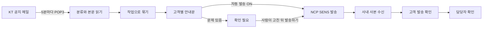

# KT Cloud 작업 공지 안내 자동화

KT Cloud가 보내는 작업 공지와 장애 공지 메일을 읽어 **고객 계정별 안내 메일을 만들고, 자동으로 보내고, 보낸 것을 확인하기까지** 한 화면에서 처리하는 사내 웹 서비스입니다.

> 공개용 사본입니다. 회사, 고객, 담당자 이름과 메일 주소, 서버 주소는 예시 값으로 바꿨고, 운영 기록 문서는 뺐습니다.

<br>

## 왜 만들었나

KT Cloud를 재판매하는 회사는 KT가 점검이나 장애를 알릴 때마다 그 계정을 쓰는 고객에게 같은 내용을 다시 알려야 합니다. 손으로 하면 이렇게 됩니다.

1. 메일함에서 KT 공지를 찾는다 (하루 수백 통 중 몇 통)
2. 공지에 적힌 계정이 어느 고객사인지, 누구에게 보내야 하는지 찾는다
3. 안내문을 쓰고, 받는 사람을 붙여 넣어 보낸다
4. 보냈는지, 누가 확인했는지 따로 적어 둔다

계정이 많고 KT가 같은 공지를 여러 번 보내기 때문에 빠뜨리거나 두 번 보내기 쉽습니다. 이 서비스는 1~4를 자동으로 하고, 사람은 **자동으로 처리하지 못한 것만 보고 마지막 확인만** 하면 되게 만듭니다.

<br>

## 주요 기능

| 기능 | 설명 |
|---|---|
| **메일 수집** | 5분마다 POP3로 새 메일만 읽습니다. 메일 서버의 메일은 지우거나 바꾸지 않습니다 (읽기 전용). |
| **공지 분류** | 제목으로 작업, 완료, 취소/변경, 연기, 긴급, 장애 발생/복구, 서비스 점검 요청 공지를 나누고, 본문에서 대상 계정, 서버, 작업 일시를 읽습니다. |
| **작업 묶기** | 같은 작업의 공지를 한 작업으로 묶습니다. KT가 같은 메일을 두 번 보내면 하나로 접고, 며칠 뒤 다시 보내면 2차, 3차로 나눕니다. |
| **안내문 작성** | 고객 정보에서 받는 사람을 찾고, 회사 문구로 안내문을 만듭니다. |
| **자동 발송** | NCP SENS 메일 API로 보냅니다. 같은 안내를 두 번 보내지 않는 규칙이 가장 먼저입니다 (아래). |
| **발송 확인** | 보낸 메일의 사내 사본이 메일함에 들어오면 계정, 공지 종류, 작업 일시로 안내와 맞춰 봅니다. 담당자는 이름을 적고 확인합니다. |
| **확인 필요** | 고객 정보에 없는 계정, 읽지 못한 메일, 늦은 발송, 발송 실패를 모든 탭에서 한곳에 모읍니다. |
| **별도 발송 고객** | 협력사가 대신 보내는 고객은 따로 다루고, 서버별 받는 사람 그룹으로 안내를 나눕니다. |
| **작업 기록, 달력** | 안내 한 건을 한 줄로 남겨 CSV로 내려받고, 월별 달력으로 일정을 봅니다. |
| **화면에서 설정** | KT가 메일 형식을 바꾸면 코드 대신 화면에서 제목 단어와 항목 이름을 고치고 미리 봅니다. |

<br>

## 흐름



안내 하나의 상태는 이렇게 지나갑니다.

```text
발송 대기 → 발송 요청됨 → 고객 발송 확인 → 담당자 확인
    └→ 확인 필요 / 발송 실패 → (사람이 처리) → 발송하기
```

<br>

## 두 번 보내지 않기

고객에게 같은 메일이 두 번 가는 것이 가장 나쁜 실패라서, 발송은 다음 규칙을 지킵니다 (`notifications/dispatch.py` 맨 위).

1. **자동 발송 범위**: KT 메일을 받은 지 하루 안이고, 작업이 아직 끝나지 않은 안내만 스스로 보냅니다. 장애 공지, 서비스 점검 요청 공지, 작업 연기 공지는 바로 보냅니다.
2. **한 번에 하나**: 한 안내에 진행 중이거나 접수된 시도가 있으면 DB 제약이 두 번째 시도를 막습니다.
3. **응답이 없으면 먼저 확인**: SENS가 받았을 수도 있는 시도는, SENS 발송 목록에서 본문 해시까지 같은 요청을 찾아본 뒤에만 다시 보냅니다.
4. **재시도는 확실할 때만**: 아무것도 접수되지 않은 게 확실한 실패만 5분 뒤 다시 보내고, 3번이면 사람에게 넘깁니다.
5. **접수된 메일은 끝**: SENS가 받은 메일은 다시 보내지 않고, SENS의 결과로 상태를 정합니다.
6. **보내기 직전 확인**: 사람이 같은 SENS로 손으로 보낸 메일(같은 받는 사람, 같은 제목)이 있으면 보내지 않고 보류합니다.

<br>

## 기술 구성

| 영역 | 사용 |
|---|---|
| 서버 | Python 3.12, Django 5.2, gunicorn, nginx |
| DB | SQLite (WAL), 매일 백업, 1년 보관 |
| 실행 | systemd 타이머(5분 수집), path 유닛(화면의 '새 메일 확인'), 서비스 계정 |
| 메일 | POP3 (수신, 읽기 전용), NCP SENS 메일 v2 API (발송) |
| 고객 정보 | 회사 운영 DB의 MySQL 뷰 (읽기 전용), CSV, 화면 입력 |
| 화면 | 서버 렌더링 템플릿, 빌드 단계와 외부 CDN 없음, 라이트/다크 모드 |
| 테스트 | pytest, 가짜 POP3 서버, 가짜 SENS (실제 메일과 발송 없음) |

<br>

## 폴더 구조

```text
.
├── cspnotice/            Django 설정
├── mailcollect/          메일 수집과 KT 공지 읽기
│   ├── pop3.py           POP3 (읽기 전용)
│   ├── scanner.py        수집 1회
│   ├── headers.py        메일 분류
│   ├── ktform.py         KT 공지 양식 (화면에서 고치는 규칙)
│   ├── notices.py        본문 항목 읽기
│   └── notice_store.py   공지 저장, 작업 묶기
├── notifications/        고객 안내와 발송
│   ├── service.py        안내 만들기, 보낸 메일 대조
│   ├── drafts.py         안내 문구
│   ├── dispatch.py       자동 발송 규칙
│   ├── sens.py           NCP SENS API
│   └── records.py        작업 기록
├── customers/            고객 정보, 운영 DB 연동, 별도 발송 그룹
├── web/                  화면 (views, templates, static)
├── suggestions/          건의사항
├── tests/                테스트
├── ops/                  배포, systemd, nginx, 서버 이관
└── docs/                 운영 안내, 서버 이관
```

서버에서는 이렇게 놓입니다.

```text
/data/csp-notice/
├── app/          코드 (git)
├── release/      실제로 도는 코드 (ops/deploy.sh만 갱신)
├── venv/         Python 가상환경
├── var/          DB와 실행 상태
└── backup/       매일 DB 백업
/etc/csp-notice/  접속 정보 (pop3.env, sens.env, opsdb.env, secret_key)
```

<br>

## 시작하기

```bash
python3.12 -m venv .venv
.venv/bin/pip install -r requirements-dev.txt
.venv/bin/python -m pytest              # 실제 메일 접속과 발송 없이 전부 돕니다
```

개발 서버는 경로와 키를 환경 변수로 넘겨 띄웁니다.

```bash
export CSP_VAR_DIR=./var CSP_SECRET_KEY=dev CSP_STATIC_ROOT=./static
.venv/bin/python manage.py migrate
.venv/bin/python manage.py createsuperuser
.venv/bin/python manage.py runserver
```

메일 수집, 발송, 운영 DB는 각 설정 파일이 있을 때만 켜집니다. 설정 형식과 운영 명령은 [docs/OPERATIONS.md](docs/OPERATIONS.md), 서버 설치와 이관은 [docs/MIGRATION.md](docs/MIGRATION.md)에 있습니다.

<br>

## 원칙

- **메일함은 읽기만** 합니다. POP3 `DELE`를 보내지 않습니다.
- **비밀 값은 저장소 밖** `/etc/csp-notice/`에만 둡니다.
- **실제 고객 정보는 코드, 테스트, 문서, 로그에 넣지 않습니다.** 테스트는 `example.invalid` 주소만 씁니다.
- **사람이 마지막에 확인**합니다. 자동으로 판단하지 못한 것은 보내지 않고 '확인 필요'로 넘깁니다.
